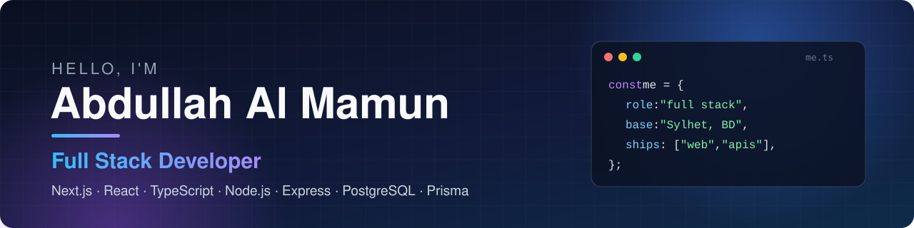

<!--- banner --->

  

<!--- name & designation --->
<h1 align="center">Hi 👋, I'm Abdullah Al Mamun</h1>
<h3 align="center">Full Stack Developer · Sylhet, Bangladesh 🇧🇩</h3>

  

 

<!--- about me --->

## 🧑‍💻 About Me

I'm a full stack developer from Sylhet, Bangladesh who builds web apps end to end in TypeScript.
On the frontend I work with React and Next.js; on the backend I build REST APIs with Node.js, Express, PostgreSQL and Prisma.
I enjoy the hard parts of real products: payments, booking logic that can't double-book, transactional emails, multi-language UIs and practical AI features.
I care about clean architecture, fast pages and code that's easy for the next person to read.

 

<!--- current activities --->

## 🚀 What I'm Doing Now

- 🏕️ I'm building **[GearUp](https://github.com/abdullahmamun1/gearUp-frontend)**, a gear rental marketplace with Stripe payments and deposits, live availability, and English + Bangla support.
- ⚡ I'm exploring **Next.js 16** (App Router, static rendering, Server Actions and view transitions).
- 🤖 I'm adding **AI features with Google Gemini**: a trip planner, listing drafts and review summaries.
- 🧪 I'm working on **DevBench**, another full stack TypeScript project ([frontend](https://github.com/abdullahmamun1/devbench-frontend) · [backend](https://github.com/abdullahmamun1/devbench-backend-api)).
- 🐳 I'm learning **Docker and AWS**.
- 💬 Ask me about **React, Next.js, Node.js, Express, PostgreSQL and Prisma**.

 

<!--- skills --->

## 🛠️ Skills

### Languages

  

### Frontend

  

### Backend

  

### DevOps & Deployment

  

### Tools & Design

  

 

<!--- socials --->

## 🌐 Connect With Me

  
  
  
  

 

<!--- github stats --->

## 📊 GitHub Stats

  
  

  

### 🐍 Contribution Snake

<picture>
  <source media="(prefers-color-scheme: dark)" srcset="https://raw.githubusercontent.com/abdullahmamun1/abdullahmamun1/output/github-contribution-grid-snake-dark.svg">
  <source media="(prefers-color-scheme: light)" srcset="https://raw.githubusercontent.com/abdullahmamun1/abdullahmamun1/output/github-contribution-grid-snake.svg">
  
</picture>

---

  

